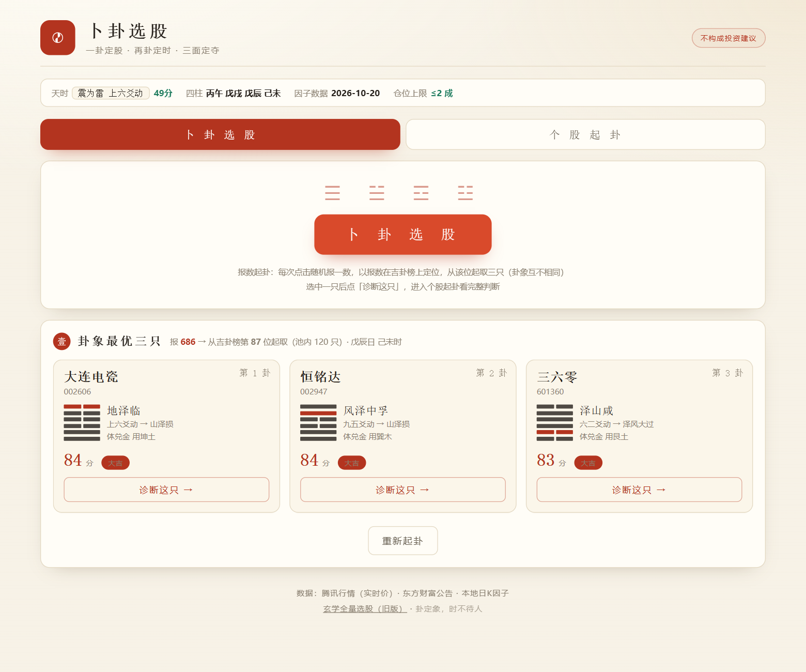
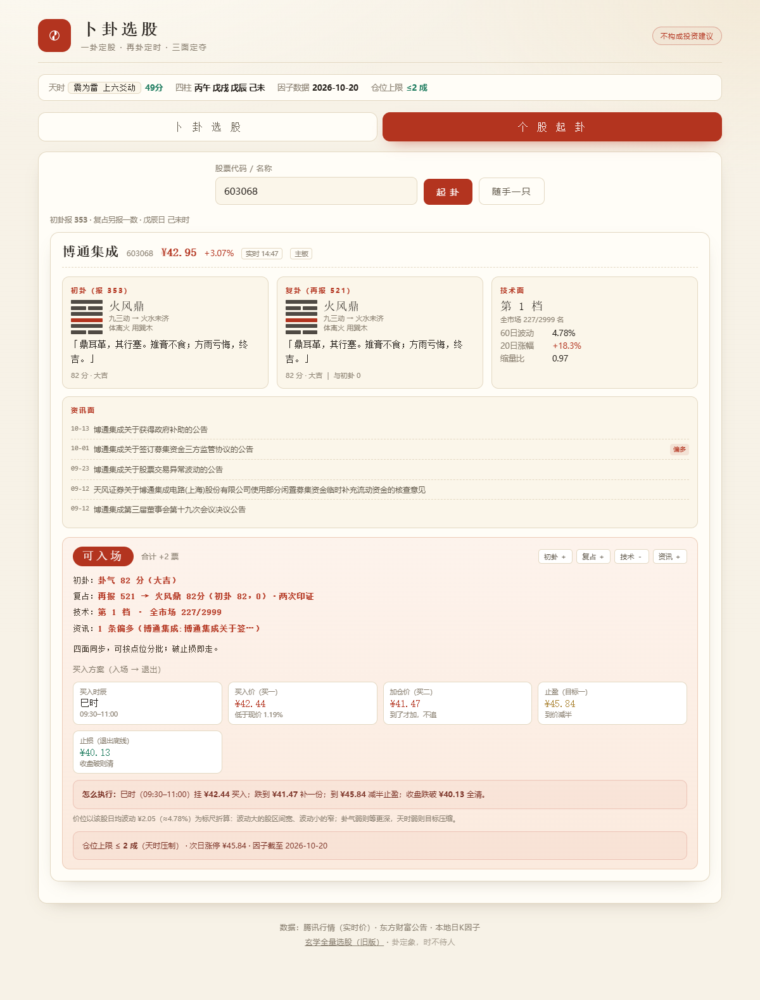

# I Ching Stock — Hexagram-Based Stock Screener

> A programmatic tool that casts **Meihua Yishu (梅花易数)** hexagrams for A-share stocks, then combines them with technical factors and company announcements to answer one question: *can I enter, and at what price?*
>
> ⚠️ **This is a traditional-culture research and engineering project. It is NOT investment advice.** Our own backtest shows the hexagram score has **no predictive power** (IC ≈ 0.0007). That finding matters more than the features — please read [Backtest](#backtest-read-this-first) first.

[中文版](README.md) ｜ **English**

Live demo: https://xuanxue-stock.app.workbuddy.host/?sharecode=OYYVCCG5LE




---

## What it does

Two independent tabs:

| Tab | Description |
|---|---|
| **Hexagram Screening** | One click casts hexagrams for the whole market and returns the three best (all with distinct hexagrams). Every click **draws a random number**, so results differ each time |
| **Single-Stock Reading** | Enter a ticker or name (pinyin initials like `gzmt` work) to get a full reading: primary hexagram + re-cast hexagram + technicals + announcements + a trade plan |

Clicking "Diagnose this one" jumps to the second tab with the ticker pre-filled.

---

## How it works

### 1. Number-casting (报数起卦)

Meihua Yishu has a traditional "number casting" method. This tool merges it with the ticker and the current time:

```
T  = year-branch + lunar month + lunar day + hour-branch
Upper trigram = (ticker + draw × 7) % 8       (0 → 8)
Lower trigram = (sum of last 3 digits + T + draw × 3) % 8
Moving line   = (ticker + T + draw × 5) % 6   (0 → 6)
```

**Why three different multipliers (7 / 3 / 5)?** If the same draw were added to all three terms, the entire market's hexagrams would shift by one step together — the hexagram *names* would never change, only which stocks land on them. Coprime multipliers are what make the draw actually reshape the hexagrams.

**Why screening uses "position by draw":** the score depends only on (hexagram, moving line), so the market-wide maximum is always the same two or three hexagrams. Taking the top 3 would return the same three hexagrams every time. Instead we take the **top 120** by score (min 81 that hour) and use `draw % 120` as a starting offset, then walk forward collecting three distinct hexagrams.

### 2. Double casting — ask the stock, then ask again

- **Primary cast** with draw N₁ sets the candidate and base score
- **Re-cast** the chosen stock with a fresh draw N₂
- If one is auspicious and the other weak → "contradictory, abstain"; if aligned, they corroborate each other

Note: when `N₂ − N₁` is a multiple of 24, all three terms reset simultaneously and the two hexagrams become identical — the code avoids that case.

### 3. Three-sided vote (4 ballots)

| Ballot | +1 | 0 | −1 |
|---|---|---|---|
| **Primary cast** | score ≥ 66 | 52–65 | < 52 (inauspicious name: another −1) |
| **Re-cast** | score ≥ 66 | 52–65 | < 52; abstains if it contradicts the primary |
| **Technicals** | decile 3–10 | decile 2 | decile 1 (worst 10%) |
| **Announcements** | buyback / increase / contract win / profit alert | all neutral | selling / investigation / loss / regulatory inquiry |

Total **≥2 Enter ｜ 1 Small probe ｜ 0 Wait ｜ ≤−1 Avoid**.

Technical score = low volatility (60-day stdev, negated) + reversal (20-day return, negated) + volume shrinkage (5d/60d average volume, negated), MAD-winsorised, **size-neutralised** by 20-day turnover quintile, then ranked into deciles.

### 4. Price levels — scaled by each stock's own volatility

An earlier version used fixed percentages; it produced levels that were too deep for low-volatility names and too shallow for high-volatility ones — basically unfillable. Now everything is ATR-based:

```
ATR ≈ price × 60-day average daily volatility

Buy 1  = price − ATR × (0.25 + 0.25×(1−k)) × line-factor
Buy 2  = price − ATR × (0.75 + 0.55×(1−k)) × line-factor
Stop   = Buy2  − ATR × (0.60 + 0.30×(1−k))
Target = price + ATR × (1.2 + 1.3k) × trend-factor × market-factor
```

where `k = score/100`, line-factor is 0.85 for a yang moving line and 1.10 for yin, trend-factor is 0.75 when the changed hexagram deteriorates, and market-factor is `0.85 + 0.3×(market score/100)`. Levels are finally capped at the next-day limit-up price and snapped to the ¥0.01 tick.

The effect: a 1%-volatility bank stock gets a buy-1 only 0.4% below spot, while a 4.8%-volatility small cap gets 2%.

**Exit plan** (when the verdict is Wait/Avoid): weak stocks (body trigram suppressed, or score < 52) get a morning-session exit 09:30–10:30, otherwise the favourable hour; trim prices = spot + 0.35 / 0.75 × ATR, break-down exit = spot − 0.9 × ATR.

---

## Backtest (read this first)

Strict T+1 simulation on 3,051 main-board stocks × 30 trading days (2026-09-02 → 2026-10-21, 91,240 stock-days), daily bars from Tencent/Sina:

| Metric | Result |
|---|---|
| Win rate | **44.0%** |
| Average per trade | **−0.05%** (after 0.1% cost) |
| vs. open-to-close baseline | excess **+0.01 pp/trade** |
| Spearman ρ (score vs next-day return) | **0.0069** |

Cross-sectional factor IC (303 trading days, predicting 5-day forward return):

| Factor | IC | t-stat | IC > 0 |
|---|---|---|---|
| Volume shrinkage | 0.0378 | 6.7 | 63.6% |
| Low volatility | 0.0700 | 5.3 | 63.2% |
| Oversold | 0.0416 | 4.6 | 61.1% |
| 20-day momentum | −0.0524 | −5.8 | 37.5% (momentum reverses in A-shares) |
| **Hexagram score** | **0.0007** | **0.4** | **50.0%** |

**Conclusion:** the hexagram score is uncorrelated with returns, and this is a *mathematical necessity* — the hexagram depends only on (ticker, date, hour, draw) and is completely independent of price, volume and fundamentals. No exit rule can fix that; it can only reshape the P&L distribution:

| Exit config | Win rate | Expectancy per trade (with gap slippage) |
|---|---|---|
| Target 0.5% / stop 5% / hold 5d | 70.8% | **−1.21%** |
| Target 5% / stop 0.5% / hold 1d | 26.9% | −0.63% |

**Win rate is a dial, not a skill.** Trading a higher win rate costs you a larger average loss. The real value of this project is not prediction — it is turning *how much, at what price, and what to do when wrong* into disciplined, reviewable rules.

---

## Repository layout

```
.
├── 卜卦选股.html                  # Built app — open directly in a browser
├── 周易玄学选股.html               # Legacy full-market hexagram ranking (built)
├── 玄学选股报告-2026-10-20.html     # Archived full-market scan snapshot
├── _ref/                         # Sources and scripts
│   ├── pick_page.html            #   App template (engine placeholder)
│   ├── app_template.html         #   Legacy template + hexagram engine
│   ├── build_pick.js             #   Inject engine + data → 卜卦选股.html
│   ├── prep_site.js              #   Produce deployable site/
│   ├── build_full.js             #   Fetch full-market quotes → data.json
│   ├── build_factor_data.js      #   Compute technical factors → factor_data.json
│   ├── data.json                 #   64 hexagrams (text) + calendar + quote snapshot
│   ├── factor_data.json          #   Volatility / reversal / shrinkage for 2,999 stocks
│   ├── test_engine.js            #   25 engine assertions
│   ├── backtest.js / 2 / 3       #   T+1 backtest, parameter sweep, slippage fix
│   ├── factor_ic.js              #   Factor IC comparison
│   └── portfolio.js              #   Portfolio backtest
├── docs/                         # README images
└── legacy/                       # Superseded pages (merged into the main app)
```

## Running locally

No build step needed — just open `卜卦选股.html`. Or serve it (some browsers are stricter about `file://` CORS):

```bash
npm run serve        # = python -m http.server 8899 → http://127.0.0.1:8899/
npm test             # engine unit tests
npm run build        # regenerate pages after editing templates in _ref/
```

Regenerate the quote snapshot (requires `npm i` for pinyin-pro):

```bash
node _ref/build_full.js          # fetch all A-share quotes → data.json
node _ref/build_factor_data.js   # needs _ref/kline800.json (see below)
```

## Data sources & known limits

- **Quotes**: Tencent `qt.gtimg.cn` (primary) → Eastmoney `push2.eastmoney.com` (independent vendor fallback) → Tencent `web.ifzq.gtimg.cn` → `<script>` tag
- **Announcements**: Eastmoney `np-anotice-stock.eastmoney.com`. This endpoint **rejects requests carrying a foreign `Referer`** (HTTP 567), so `referrerPolicy: 'no-referrer'` is mandatory
- **Technicals** come from a local daily-bar snapshot (see the date inside `factor_data.json`) and are **not real-time**; prices are live. When the two disagree, trust the on-page labels
- Universe: 2,999 Shanghai/Shenzhen main-board stocks (ChiNext, STAR and BSE are excluded — no trading permission)
- Hexagram scoring has **no predictive power**; segment testing shows "buy the top decile" is unstable and only "exclude the worst decile" holds up

## Disclaimer

A programmatic interpretation of the *I Ching* text and an engineering exercise:

- **Not investment advice**; no return is promised
- All price levels are mechanically computed by public formulas and have not been validated in live trading
- Market data belongs to its providers — respect their terms, do not redistribute commercially
- Trade at your own risk

## License

[MIT](LICENSE) © 2026 Toms
